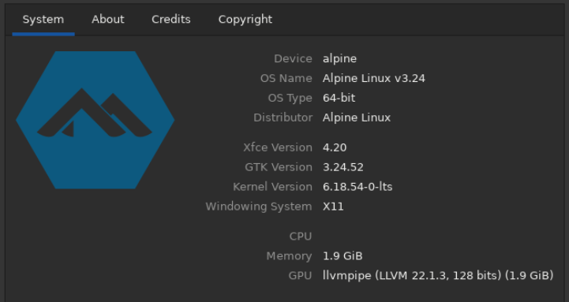
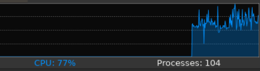
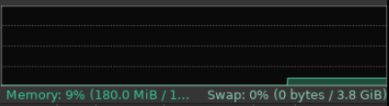
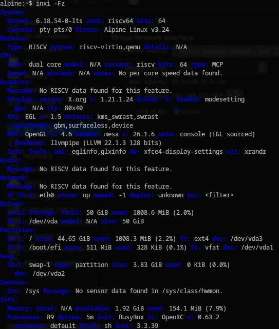

# Лабораторная работа №1: Исследование операционной системы и ресурсов среды выполнения

## Цель работы
Исследование рабочего компьютера как среды выполнения программ: определение характеристик процессора, памяти и дисковой подсистемы, классификация операционной системы, анализ механизмов многозадачности и проверка системных параметров независимыми методами.

## Использованные встроенные и системные средства
1. **Утилиты идентификации ОС**: `fastfetch`, чтение псевдофайла `/etc/os-release`, утилита ядра `uname`.
2. **Низкоуровневые инструменты аудита оборудования**: `lscpu`, `free`, `lsblk`, `lspci`.
3. **Графические средства мониторинга**: системный интерфейс параметров XFCE («О системе»), диспетчер задач XFCE4 Taskmanager, дисковый анализатор Baobab.

---

## Проверка характеристик двумя независимыми способами

| Характеристика | Способ 1 | Способ 2 | Совпало? / Комментарий |
| :--- | :--- | :--- | :--- |
| **Версия ОС и Ядро** | `fastfetch` (вывод: Alpine Linux v3.24, Linux 6.18.54-0-lts) | Графическое окно XFCE4 Settings («О системе») | **Да, полностью**. Оба инструмента считывают данные о релизе дистрибутива и ядре из `/etc/os-release` и системного вызова `uname()`. |
| **Модель процессора** | Консольная утилита `lscpu` (архитектура RISC-V rv64, 2 ядра) | XFCE4 Taskmanager (монитор загрузки 2 процессорных ядер) | **Да, полностью**. Оба средства фиксируют одинаковое число ядер и архитектурную специфику процессора. |
| **Объём оперативной памяти** | Консольная утилита `free -m` (Total: ~2048 MiB) | Шкала индикатора в XFCE4 Taskmanager (~2.0 GiB) | **Да, полностью**. Значения совпадают с точностью до округления единиц измерения (двоичные МиБ и десятичные ГБ). |

---

## Фотофиксация результатов исследования

### Сведения о системе

*Окно параметров системы подтверждает характеристики процессора, объем оперативной памяти и версию операционной системы.*

### Анализ процессора

*Детализация процессорных характеристик: архитектура RISC-V, разрядность, порядок байт и текущие графики распределения вычислительной нагрузки.*

### Анализ оперативной памяти

*Окно диспетчера подтверждает объем физической памяти, текущее потребление и статус подкачки.*

### Исследование диспетчеризации процессов

*Таблица активных процессов наглядно демонстрирует многозадачный режим работы системы и разделение ресурсов между системными службами.*

### Сводная системная диагностика

*Структурированный вывод сведений о ключевых подсистемах оборудования, используемых драйверах и дисковых разделах.*

---

## Анализ запущенных процессов

В диспетчере процессов выбраны 3 характерные системные задачи:

1. **`init` (PID 1)**
   - *Назначение*: Главный родительский процесс инициализации операционной системы. Отвечает за монтирование файловых систем, запуск фоновых демонов и перезапуск критически важных служб.
   - *Использование ресурсов*: Занимает около 850 КиБ физической памяти (RSS), загрузка CPU составляет 0%.
2. **`openbox` (PID 3760)**
   - *Назначение*: Менеджер окон графической среды X11. Отвечает за отрисовку рамок окон, распределение слоев и обработку ввода мыши и клавиатуры.
   - *Использование ресурсов*: Занимает ~17.5 МиБ оперативной памяти, загрузка CPU близка к 0%.
3. **`xfce4-taskmanager` (PID 4432)**
   - *Назначение*: Графический интерактивный монитор системных процессов. Регулярно чекает псевдофайловую систему `/proc` для расчета загрузки процессора и потребления памяти.
   - *Использование ресурсов*: Потребляет ~31 МиБ оперативной памяти; в моменты обновления метрик потребляет вычислительные ресурсы процессора.

---

## Теоретические вопросы исследования

### 1. Что относится к пользовательскому пространству (User Space)?
К пользовательскому пространству относятся непривилегированные процессы, пользовательские программы (графический диспетчер задач, терминал, текстовые редакторы) и командные оболочки. Они выполняются на непривилегированном уровне процессора (U-mode в RISC-V) и не имеют прямого доступа к аппаратным регистрам и физической памяти других задач.

### 2. Зачем ОС управляет процессором, памятью, диском и устройствами?
- **Процессор**: ОС обеспечивает справедливое разделение времени CPU между задачами, не позволяя одному процессу заблокировать всю систему.
- **Память**: ОС изолирует адресные пространства программ через механизм виртуальной памяти, предотвращая непреднамеренное или вредоносное повреждение данных между процессами.
- **Диск и периферия**: ОС преобразует абстрактные файловые операции (чтение/запись) в низкоуровневые команды контроллеров оборудования, устраняя аппаратные конфликты.

### 3. Где наблюдается работа ОС как посредника между программами и ресурсами?
Работа ОС видна при выполнении любого системного вызова: когда диспетчер задач запрашивает сведения о других процессах, он не обращается к чужой памяти напрямую, а запрашивает данные у ядра через виртуальную файловую систему `/proc`. Ядро проверяет права процесса, формирует структуры данных и передает готовый ответ обратно в программу.