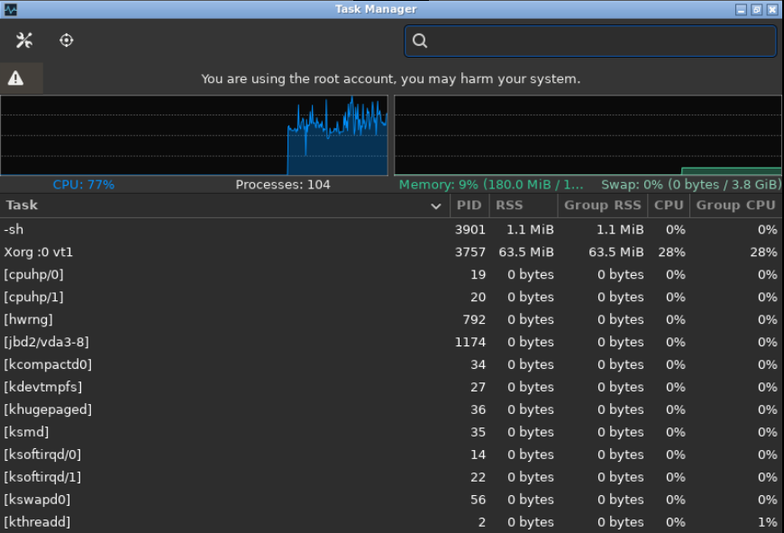

# Классификация операционной системы рабочего компьютера

## Задание 1. Классификация установленной ОС (Alpine Linux riscv64)

1. **Назначение: Настольная / Встроенная (комбинированная)**
   - *Почему так считаю*: Alpine Linux совмещает ультралегковесный фундамент, ориентированный на встроенные устройства и сетевые узлы, с возможностью запуска полноценного графического окружения для работы пользователя.
   - *Подтверждение на ПК*: Сверхнизкое потребление RAM (~200 МБ) в сочетании с запущенным оконным менеджером Openbox и графическими приложениями.

2. **Число одновременно выполняемых задач: Многозадачная с вытеснением (Preemptive Multitasking)**
   - *Почему так считаю*: Ядро Linux берет на себя планирование выполнения процессов и распределение квантов времени процессора без ожидания добровольной передачи управления от программ.
   - *Подтверждение на ПК*: Одновременное параллельное выполнение системного процесса инициализации, демона SSH, оконного менеджера и пользовательского терминала.
   
   
   *Рисунок 1 — Подтверждение многозадачности: параллельная работа системных и прикладных процессов с разделением PID и аппаратных ресурсов.*

3. **Работа с пользователями: Многопользовательская (Multi-user)**
   - *Почему так считаю*: Архитектура ядра обеспечивает строгую изоляцию пользователей на уровне файловых прав (POSIX permissions), раздельные идентификаторы UID/GID и контроль доступа суперпользователя.
   - *Подтверждение на ПК*: Наличие непривилегированного пользователя и изолированного аккаунта администратора `root` с делегированием прав через утилиту `doas`.

4. **Интерфейс: Комбинированный (CLI + GUI)**
   - *Почему так считаю*: Система предоставляет полноценные возможности управления как через командную строку, так и через графическую оконную среду X11.
   - *Подтверждение на ПК*: Доступность графических утилит (Baobab, диспетчер задач) наряду со стандартной командной оболочкой sh/ash.

5. **Сфера применения: Общего назначения**
   - *Почему так считаю*: ОС ориентирована на широкий класс задач (разработка, вычисления, системное администрирование), предоставляя стандартный интерфейс POSIX без ограничений по детерминированности времени отклика.
   - *Подтверждение на ПК*: Стандартная файловая иерархия, компиляторы и утилиты общего назначения.

6. **Поддержка сети: Сетевая ОС**
   - *Почему так считаю*: Сетевой стек интегрирован в ядро, поддерживаются все ключевые сетевые протоколы и службы удаленного доступа.
   - *Подтверждение на ПК*: Активный сервис `sshd` для удаленного администрирования и процесс DHCP-клиента `udhcpc`.

---

## Задание 2. Сравнительный анализ операционных систем

| ОС | Где применяется | Тип по назначению | Многозадачность | Интерфейс | Ключевое отличие |
| :--- | :--- | :--- | :--- | :--- | :--- |
| **Alpine Linux (riscv64)** | Рабочие станции RISC-V, серверы, сетевые узлы, микроконтейнеры | Настольная / Встроенная | Вытесняющая многозадачность | Комбинированный (CLI / X11) | Компактная стандартная библиотека `musl libc` вместо `glibc`, система инициализации OpenRC, отсутствие systemd. |
| **Ubuntu Linux** | Рабочие станции, корпоративные серверы, дата-центры | Настольная / Серверная | Вытесняющая многозадачность | Графический (GNOME) + CLI | Большая пакетная база, стандартная библиотека `glibc`, использование подсистемы инициализации `systemd`. |
| **Android** | Смартфоны, планшетные ПК, мультимедиа-системы автомобилей | Мобильная ОС | Вытесняющая многозадачность | Сенсорный графический UI | Специализированная среда выполнения приложений ART/Dalvik, оптимизация под энергосбережение и жесткая песочница процессов. |
| **FreeRTOS** | Микроконтроллеры, IoT-устройства, промышленная автоматика | ОС реального времени (RTOS) | Кооперативная или строгая вытесняющая | Программный API (CLI при необходимости) | Строго детерминированное время реакции на внешние события, минимальное потребление памяти (единицы килобайт), отсутствие тяжелого GUI. |

### Почему операционные системы не могут быть универсальными для всех задач?
Каждая операционная система создается под определенные аппаратные условия и требования к надежности. Операционные системы общего назначения ориентированы на удобство интерактивной работы, запуск разнообразного пользовательского ПО и высокую пропускную способность, жертвуя строгой предсказуемостью времени отклика. 

Системы реального времени (RTOS) проектируются с гарантированным детерминизмом: задержка реакции на прерывание строго фиксирована, что критично в автомобильной электронике или медицине, однако они не способны поддерживать тяжелые приложения. 

Мобильные платформы вынуждены ставить во главу угла энергоэффективность и изоляцию фоновых программ, а специализированные легковесные ОС (как Alpine) оптимизированы под минимальный размер дистрибутива и безопасность за счет исключения тяжелых компонентов.