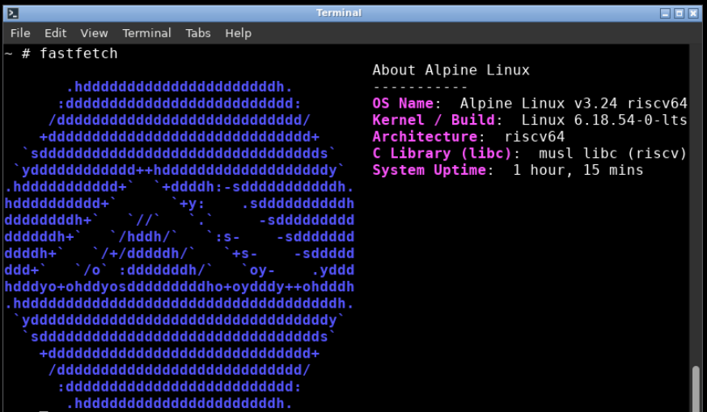
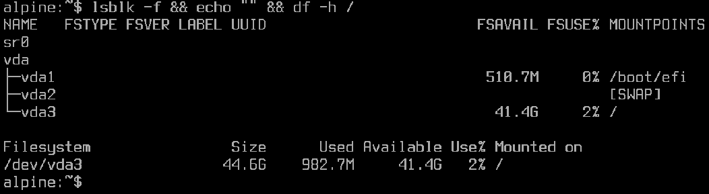

# Системный паспорт рабочего компьютера

**Дата диагностики:** 01 октября 2026 г.  
**Использованные инструменты:** Fastfetch, XFCE4 Settings («О системе»), XFCE4 Taskmanager, Baobab Disk Usage Analyzer, Mesa-demos (`glxinfo`), стандартные системные утилиты ядра Linux (`uname`, `lscpu`, `free`, `lsblk`, `lspci`).

## Сводная таблица характеристик

| Параметр | Значение | Метод получения |
| :--- | :--- | :--- |
| **Операционная система** | Alpine Linux v3.24 | Fastfetch / `/etc/os-release` |
| **Версия ядра** | 6.18.54-0-lts | `uname -r` |
| **C-библиотека (libc)** | musl libc (1.2.x) | `ldd --version` |
| **Архитектура системы** | RISC-V 64-bit (`riscv64`) | `uname -m` / `lscpu` |
| **Процессор (CPU)** | RISC-V Processor (rv64gc) | `lscpu` / XFCE4 Settings |
| **Количество ядер / потоков** | 2 ядра | `nproc` / Диспетчер задач |
| **Текущая загрузка CPU** | Фоновая ~1–5%, пиковая при открытии утилит ~50–60% | XFCE4 Taskmanager |
| **Оперативная память (RAM)** | 2048 МиБ (2.0 GiB) | `free -m` / Taskmanager |
| **Занято RAM в покое** | ~180–220 МиБ | `free -h` |
| **Накопитель** | Системный диск `/dev/vda`, емкость ~50 GiB | `lsblk` / Baobab |
| **Файловая система** | ext4 (точка монтирования `/`) | `df -Th /` |
| **Графическая подсистема** | VirtIO GPU / Gallium llvmpipe | `lspci` / `glxinfo` |
| **Оконная подсистема** | X.Org Server + Openbox WM | `xinit` / Fastfetch |

---

## Диагностические подтверждения

### 1. Версия и сборка ОС

*Окно Fastfetch отображает версию дистрибутива Alpine Linux, релиз ядра Linux LTS, системную архитектуру riscv64 и стандартную библиотеку musl libc.*

### 2. Сведения о системе

*Графическое окно системных сведений XFCE отображает базовую аппаратную спецификацию: архитектуру процессора, объем оперативной памяти и общую конфигурацию рабочей станции.*

### 3. Процессор и вычислительные мощности

*Окно монитора ресурсов демонстрирует занятость процессора RISC-V. Эквивалента для деатльного отображения как на windows под riscv64 найдено не было.*

### 4. Оперативная память

*График диспетчера ресурсов показывает занятость физической оперативной памяти: низкое потребление базовыми сервисами и отсутствие раздела подкачки (Swap).*

### 5. Дисковая подсистема

*Набор утилит из пакета util-linux показывает список разделов + основной раздел /*

### 6. Видеосистема

*К сожалению glxinfo отказался выдавать хоть что либо сегодня поэтому тут стоит скриншот из "О Системе".*

---

## Вывод о пригодности системы
Подходил бы если бы не одно но. Windows даже не в планах на хоть какой либо risc, на linux нет gtk2 библиотек из-за какой-то плотной завязаности, гиганты по типу Debian делают сборки на него чисто для галочки а сам BIOS ведет себя временами странно.
Так же из-за того что RISC-V сейчас в большей степени стоит на одноплатных ПК по типу OrangePI мне пришлось менять параметры загрузки ядра что-бы оно не искало несуществующий паралельный порт а выводило все на экран.
Тем не менее даже не смотря на 2 гигабайта оперативной памяти RISC-V очень отлично справляется с JIT и Объектной компиляцией. VsCode тоже не в планах на эту ахитектуру ибо он на базе Electron что плохо дружит с чем либо кроме Apple Silicon и amd64.
Виртуальные машины с Linux вполне запустятся отлично. Особенно учитывая что Alpine Linux имеет встроенную комманду setup-xen-dom0 что устанавливает мощный гипервизор 1го уровня поэтому виртуальные машины работают с нативной скоостью железаю в пределах выделенных ресурсов хостом.
Моя оценка 7/10, для незнающего - ад, для понимающего - прикольный опыт.